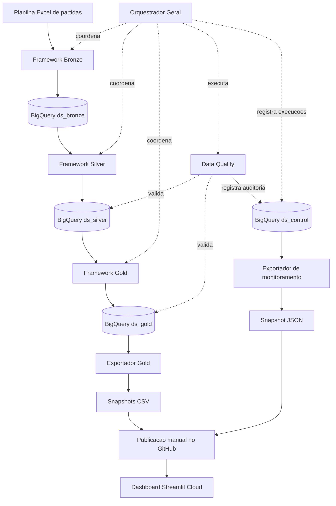

# Brasileirão Analytics | Plataforma de Dados e Dashboard

[](https://www.python.org/)
[](https://cloud.google.com/bigquery)
[](https://streamlit.io/)

**Projeto de Engenharia de Dados e Analytics aplicado ao Campeonato Brasileiro**, integrando ingestão e tratamento de dados com Python, modelagem analítica no Google BigQuery, verificações de qualidade e visualização interativa no Streamlit.

**[Acessar o dashboard](https://brasileirao-data-analytics.streamlit.app/)** · **[Explorar o repositório](https://github.com/fermiola/brasileirao-analytics)** · **[Documentação técnica da plataforma](data-platform/README.md)**

> O dashboard público utiliza snapshots CSV da camada Gold e um snapshot JSON de monitoramento exportado de `ds_control`. A navegação dos visitantes não consulta o BigQuery. O monitoramento representa o último retrato publicado, **não** o estado em tempo real.

## Visão geral

A solução separa o processamento dos dados da camada de apresentação. Os frameworks de engenharia de dados ficam em `data-platform/`; o aplicativo Streamlit apresenta os indicadores ao usuário final.

### Arquitetura




### Camadas da plataforma

| Componente | Responsabilidade |
| --- | --- |
| **Bronze** | Ingestão dos dados de origem e controle de reprocessamento de arquivos idênticos |
| **Silver** | Padronização, tipagem e consolidação das partidas, com lógica de `MERGE` |
| **Gold** | Geração das tabelas analíticas utilizadas nos indicadores |
| **Data Quality** | Execução de regras de qualidade e registro dos resultados de auditoria |
| **Orquestrador Geral** | Execução sequencial dos frameworks e registro de status das etapas |
| **Exportadores** | Geração local dos snapshots CSV da Gold e JSON do monitoramento |
| **Orquestrador do dashboard** | Executa a exportação de monitoramento e inicia o Streamlit local, sem rodar o pipeline de dados |
| **Streamlit** | Exploração visual dos dados analíticos e do último retrato de monitoramento publicado |

## Dashboard interativo

O aplicativo disponibiliza **cinco páginas**, com Monitoramento como página inicial:

1. **Monitoramento:** última execução registrada, status das etapas e verificações de Data Quality do último lote identificado.
2. **Classificação:** acompanhamento da tabela do campeonato.
3. **Mandante x Visitante:** comparação do desempenho dos clubes em casa e fora.
4. **Evolução por rodada:** análise da trajetória dos indicadores ao longo do campeonato.
5. **Forma recente:** visualização do desempenho nas partidas mais recentes.

**Dashboard:** https://brasileirao-data-analytics.streamlit.app/

## Modelo analítico no BigQuery

A camada Gold disponibiliza quatro tabelas:

| Tabela | Conteúdo |
| --- | --- |
| `ds_gold.tb_classificacao` | Classificação dos clubes |
| `ds_gold.tb_desempenho_clube` | Indicadores por clube e condição de mando |
| `ds_gold.tb_estatisticas_rodada` | Indicadores organizados por rodada |
| `ds_gold.tb_forma_recente` | Forma recente dos clubes |

Os datasets de controle e auditoria ficam em `ds_control`. O processamento é realizado no projeto GCP configurado para a plataforma; para executar em outro ambiente, revise os arquivos de configuração.

## Estrutura do repositório

```text
brasileirao-analytics/
├── dashboard/
│   ├── app.py                   # Aplicação Streamlit
│   ├── config.json              # Configuração de leitura
│   ├── exportar_gold.py         # Exportação local da Gold
│   ├── exportar_monitoramento.py # Exportação local dos logs e DQ
│   ├── orquestrador_dashboard.py # Exporta monitoramento e inicia Streamlit
│   ├── requirements.txt         # Dependências do dashboard
│   ├── data/                    # Quatro snapshots CSV e monitoramento.json
│   └── README.md                # Guia do dashboard
├── data-platform/
│   ├── README.md                # Guia técnico da plataforma
│   ├── requirements.txt         # Dependências consolidadas
│   ├── framework_bronze_generico/
│   ├── framework_silver/
│   ├── framework_gold/
│   ├── framework_data_quality/
│   ├── Orquestrador_Geral/
│   └── sql_setup/
├── .gitignore
└── README.md                    # Visão geral do projeto
```

## Como executar o dashboard localmente

Acesse a pasta `dashboard/`, onde estão o `app.py`, as dependências e os CSVs. Para usar o modo CSV, não é necessário autenticar no Google Cloud.

```powershell
cd dashboard
python -m venv .venv
.venv\Scripts\Activate.ps1
python -m pip install -r requirements.txt
python -m streamlit run app.py
```

Para **atualizar o monitoramento e iniciar o dashboard local em sequência**, com autenticação e acesso ao BigQuery configurados, use na pasta `dashboard/`:

```powershell
python orquestrador_dashboard.py
```

Esse orquestrador executa `exportar_monitoramento.py` e depois inicia o Streamlit. **Não** executa Bronze, Silver, Gold ou Data Quality e **não** publica arquivos no GitHub. A exportação exige `google-cloud-bigquery` instalado no ambiente Python utilizado.

Se usar Google Cloud SDK Shell ou outro terminal com ambiente virtual já ativado, não precisa criar outro. Em `dashboard/config.json`, `"data_mode": "csv"` utiliza os snapshots locais. Consulte o [guia do dashboard](dashboard/README.md) para exportação e modo BigQuery.

**Aplicativo publicado:** [Brasileirão Data Analytics](https://brasileirao-data-analytics.streamlit.app/) — arquivo principal `dashboard/app.py` na branch `main`.

## Como executar a plataforma de dados

Para reproduzir o pipeline, são necessários um projeto Google Cloud com BigQuery habilitado, permissões apropriadas, autenticação local e configurações ajustadas ao ambiente.

```powershell
cd data-platform
python -m pip install -r requirements.txt
cd Orquestrador_Geral
python orquestrador_pipeline.py --validar
```

O modo `--validar` deve ser utilizado conforme a documentação e o comportamento da versão instalada do orquestrador; **não assuma que ele é uma checagem puramente local ou sem acesso a serviços externos**. Para processamento completo, consulte o [guia técnico da plataforma](data-platform/README.md), incluindo autenticação, provisionamento e custos. A execução completa utiliza `--all`.

## Atualização dos dados

O dashboard publicado consome **quatro snapshots CSV e um JSON de monitoramento**. O pipeline de dados é executado separadamente da aplicação. Quando quiser atualizar os arquivos publicados:

1. Após atualizar a Gold, execute `python exportar_gold.py` na pasta `dashboard/`, com autenticação e permissões BigQuery configuradas, para gerar os CSVs.
2. Execute `python exportar_monitoramento.py` para gerar `dashboard/data/monitoramento.json` com os registros de execução e Data Quality disponíveis em `ds_control`. Alternativamente, `python orquestrador_dashboard.py` faz essa exportação e inicia o dashboard local.
3. Revise os CSVs e o JSON, verificando se contêm apenas dados apropriados para divulgação pública.
4. Envie **manualmente** os snapshots alterados para `dashboard/data/` no GitHub e faça o commit. O Streamlit Cloud utiliza os arquivos da versão implantada.

A data de exportação do JSON e a data da última execução do pipeline são informações distintas. O status exibido corresponde ao **último snapshot publicado**; falhas posteriores à exportação não aparecem até a próxima atualização.

**Importante:** o modo CSV evita consultas ao BigQuery durante o acesso público, mas a execução do pipeline e a exportação local podem consumir recursos cobrados do Google Cloud.

## Qualidade, rastreabilidade e boas práticas

- Separação das responsabilidades de ingestão, tratamento, modelagem e apresentação.
- Regras de qualidade para chaves, campos obrigatórios, status, placares e disponibilidade das tabelas Gold.
- Registro de execuções e auditorias no dataset de controle.
- Monitoramento publicado por snapshot JSON, incluindo status da última execução registrada e resultados de Data Quality; o conjunto atual contempla oito regras de verificação.
- Separação explícita entre o horário da execução e o horário da exportação do snapshot.
- Configurações externalizadas em arquivos JSON.
- Proteção contra reingestão desnecessária de arquivos idênticos na Bronze.
- Execução do pipeline desacoplada do acesso público ao dashboard.

## Segurança e publicação

Não publique `.venv/`, chaves de serviço, tokens, credenciais ou arquivos `.env`. Revise os JSONs antes de enviá-los. Os CSVs e o JSON de `dashboard/data/` e quaisquer planilhas incluídas no repositório tornam-se acessíveis publicamente. Revise também eventuais mensagens de erro, identificadores e metadados antes de publicar o JSON. O `.gitignore` não impede o envio manual de arquivos pela interface do GitHub.

## Documentação

O [guia do dashboard](dashboard/README.md) detalha a aplicação Streamlit. A documentação operacional completa — instalação do Google Cloud CLI/SDK Shell, autenticação, configurações, scripts SQL, execução e validações — está em **[data-platform/README.md](data-platform/README.md)**.

---

*Projeto de portfólio para demonstrar práticas de Engenharia de Dados, Analytics e desenvolvimento Python aplicadas a dados de futebol.*
