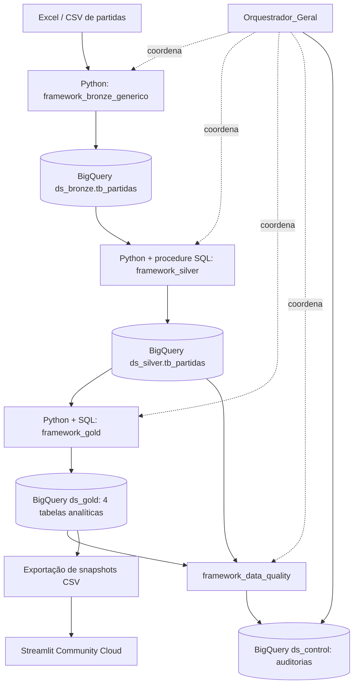

# Brasileirão Data Platform — Engenharia de Dados de ponta a ponta

Projeto de portfólio de Engenharia de Dados com **Python, Google Cloud BigQuery, arquitetura Medallion (Bronze → Silver → Gold), validação de qualidade, orquestração e dashboard Streamlit**.

**Dashboard interativo:** https://brasileirao-data-analytics.streamlit.app/  
**Repositório:** https://github.com/fermiola/brasileirao-analytics

> **Escopo deste pacote:** esta pasta contém os cinco componentes de processamento (Bronze, Silver, Gold, Data Quality e Orquestrador Geral). **Não contém** os arquivos do dashboard, que ficam em `../dashboard/` no repositório GitHub, com seu próprio `app.py`, `data/` e `requirements.txt`. **Inclui** `framework_bronze_generico/Brasileirao_Dados.xlsx` como fonte de exemplo da versão recebida. Antes de publicar, confirme que você tem direito de distribuir seus dados. A execução do zero requer provisionar os datasets e a procedure descritos abaixo.

## 1. Arquitetura e fluxo



O **Orquestrador Geral** executa sequencialmente Bronze → Silver → Gold → Data Quality no modo completo. Data Quality verifica dados Silver e Gold **depois** da construção da Gold; não é uma barreira entre Silver e Gold nesta versão.

| Componente | Arquivo principal | Responsabilidade |
|---|---|---|
| Bronze | `framework_bronze_generico/ingestao_bronze.py` | Ler arquivo, mapear campos, carregar na tabela bruta e registrar metadados de ingestão |
| Silver | `framework_silver/orquestrador_silver.py` | Tipar, validar conversões e executar MERGE via procedure parametrizada |
| Gold | `framework_gold/orquestrador_gold.py` | Executar SQLs analíticos com `CREATE OR REPLACE TABLE` |
| Data Quality | `framework_data_quality/data_quality.py` | Executar regras SQL e registrar PASS/FAIL/ERROR |
| Orquestração | `Orquestrador_Geral/orquestrador_pipeline.py` | Coordenar etapas, códigos de retorno e auditoria |

## 2. Pré-requisitos

- Python compatível com as bibliotecas instaladas (scripts escritos para Python 3.8+, mas verifique a compatibilidade das versões das dependências).
- **Google Cloud CLI (Google Cloud SDK)** instalado para autenticar a conta localmente. No Windows, você pode utilizar o **Google Cloud SDK Shell**, PowerShell ou Prompt de Comando.
- Projeto Google Cloud com BigQuery habilitado, acesso de rede e permissões para criar datasets/tabelas/procedure, executar jobs e gravar auditorias.
- Autenticação de desenvolvimento local via **Application Default Credentials** (ADC), com conta autorizada no projeto.
- Arquivo de partidas de origem, no formato configurado no JSON da Bronze.
- Custos e cotas do BigQuery podem se aplicar às consultas, cargas e operações de escrita.

### Ambiente virtual no Windows (PowerShell)

A partir da **raiz deste pacote**:

```powershell
py -m venv .venv
.\.venv\Scripts\Activate.ps1
python -m pip install --upgrade pip
python -m pip install -r requirements.txt
```

O `requirements.txt` da raiz reúne as dependências necessárias para os cinco componentes, inclusive `openpyxl` (Excel) e `google-api-core` (utilizado diretamente na Silver). Os `requirements.txt` individuais foram mantidos para uso isolado de cada framework. Se a ativação do PowerShell estiver bloqueada, use o executável `.venv\Scripts\python.exe` diretamente ou ative no Prompt de Comando.

### Instalar o Google Cloud CLI (Google Cloud SDK) no Windows

1. Baixe o instalador oficial: https://cloud.google.com/sdk/docs/install-sdk#windows.
2. Execute o instalador e conclua a instalação. Se oferecida, mantenha a opção de adicionar o `gcloud` ao `PATH`.
3. Abra o **Google Cloud SDK Shell** pelo menu Iniciar do Windows. Também é possível usar **PowerShell** ou **Prompt de Comando** se `gcloud` estiver disponível no `PATH`.
4. Verifique a instalação:

```cmd
gcloud --version
```

> **O Google Cloud SDK Shell é uma opção de terminal, não uma dependência exclusiva do projeto.** O requisito é ter o Google Cloud CLI disponível para configurar a autenticação local. Depois disso, os scripts são executados com Python em qualquer terminal compatível.

### Autenticar e configurar o projeto GCP

No Google Cloud SDK Shell (ou em outro terminal com `gcloud` disponível), execute:

```cmd
gcloud auth login
gcloud config set project brasileirao-data-platform
gcloud auth application-default login
gcloud auth application-default set-quota-project brasileirao-data-platform
```

- `gcloud auth login`: autentica o **CLI** com sua conta Google.
- `gcloud config set project`: define o projeto padrão para os comandos do CLI.
- `gcloud auth application-default login`: cria as **Application Default Credentials (ADC)** usadas pelas bibliotecas Python do Google Cloud.
- `gcloud auth application-default set-quota-project`: associa o projeto de cobrança/cotas às ADC, quando a conta tiver permissão para isso. Se ocorrer erro de permissão, confira o acesso ao projeto antes de continuar.

Confira a configuração:

```cmd
gcloud config get-value project
gcloud auth list
gcloud auth application-default print-access-token
```

O último comando apenas verifica se as ADC conseguem gerar um token: **não copie, compartilhe nem publique o token exibido**. Esses testes não garantem, isoladamente, autorização para executar consultas no BigQuery. O projeto, a API BigQuery e as permissões necessárias devem estar habilitados.

**Observação sobre terminais Windows:** os comandos `gcloud` acima funcionam no SDK Shell, PowerShell e Prompt de Comando. A seção anterior de ambiente virtual usa sintaxe **PowerShell** (`Activate.ps1`). Se estiver usando o **Google Cloud SDK Shell / Prompt de Comando**, ative o ambiente com:

```cmd
.venv\Scripts\activate.bat
```

Caso o ambiente virtual já esteja ativo (indicador `(.venv)`), não é necessário ativá-lo novamente. Execute os comandos Python a partir da raiz do projeto ou use os caminhos indicados nas seções seguintes.

**Segurança:** nunca envie credenciais ADC, tokens, arquivos `.env` ou a pasta `.venv/` para o GitHub. A autenticação local não precisa de chave JSON de conta de serviço para este fluxo de desenvolvimento.

## 3. Preparar os datasets e objetos SQL no BigQuery

Todos os objetos deste exemplo estão na localização **US** e no projeto `brasileirao-data-platform`. Ajuste os JSONs e SQLs se utilizar outro projeto.

Abra o **BigQuery Studio**, execute primeiro `sql_setup/01_criar_datasets.sql` (ou os comandos equivalentes abaixo), depois `framework_silver/sql/02_sp_merge_generico.sql`, **antes da primeira execução completa**.

### 3.1 Criar os datasets

```sql
CREATE SCHEMA IF NOT EXISTS `brasileirao-data-platform.ds_bronze`
OPTIONS(location='US', description='Camada Bronze: dados brutos');

CREATE SCHEMA IF NOT EXISTS `brasileirao-data-platform.ds_silver`
OPTIONS(location='US', description='Camada Silver: dados tratados');

CREATE SCHEMA IF NOT EXISTS `brasileirao-data-platform.ds_gold`
OPTIONS(location='US', description='Camada Gold: indicadores analíticos');

CREATE SCHEMA IF NOT EXISTS `brasileirao-data-platform.ds_control`
OPTIONS(location='US', description='Auditoria e objetos de controle');
```

**Scripts SQL incluídos nesta revisão:** `sql_setup/01_criar_datasets.sql` cria os quatro datasets; `sql_setup/02_verificar_datasets.sql` permite conferir a existência deles. A procedure Silver permanece em `framework_silver/sql/02_sp_merge_generico.sql`.

### 3.2 Criar a procedure Silver

Execute integralmente no BigQuery Studio o arquivo:

`framework_silver/sql/02_sp_merge_generico.sql`

Ele define a procedure `brasileirao-data-platform.ds_control.sp_merge_generico` utilizada pelo orquestrador Silver. **Não basta criar o dataset `ds_control`: a procedure é obrigatória.**

As tabelas de destino são criadas durante as execuções conforme as regras dos frameworks. As tabelas de auditoria de Data Quality e Orquestrador Geral também são criadas automaticamente, desde que `ds_control` já exista e a conta tenha permissão.

## 4. Configurar a fonte e revisar os JSONs

Os cinco componentes têm configurações próprias:

```text
framework_bronze_generico/config.json
framework_silver/config.json
framework_gold/config.json
framework_data_quality/config.json
Orquestrador_Geral/pipeline_config.json
```

O `framework_bronze_generico/config.json` atualmente define:

```json
"source": {
  "path": "Brasileirao_Dados.xlsx",
  "format": "xlsx",
  "sheet": "Partidas",
  "header_row": 1
}
```

Portanto, **coloque `Brasileirao_Dados.xlsx` na pasta `framework_bronze_generico/`**, com a aba `Partidas` e as colunas esperadas, ou altere `source.path` para o caminho real do arquivo. O Excel **está incluído no ZIP**. Antes de publicá-lo em um repositório público, confira a origem e a autorização de distribuição dos dados.

Os JSONs fazem referência ao projeto `brasileirao-data-platform` e à região `US`. A configuração `Orquestrador_Geral/pipeline_config.json` utiliza **caminhos relativos**, por exemplo `../framework_gold/orquestrador_gold.py`. Preserve a disposição das pastas para que a resolução funcione.

A Bronze está configurada com `WRITE_APPEND` e `skip_if_same_file: true`: arquivos com o mesmo hash são ignorados quando a proteção pode ser aplicada; **um arquivo modificado pode gerar uma nova carga**. Não force reingestões sem avaliar o impacto.

## 5. Validar localmente antes de acessar o BigQuery

A partir da raiz do pacote:

```powershell
python .\Orquestrador_Geral\orquestrador_pipeline.py --validar
```

O modo `--validar` verifica configurações e arquivos locais e **não executa jobs no BigQuery**. Ele não garante que os SQLs serão aceitos pelo BigQuery nem que as permissões e fontes de dados estejam corretas.

Também é possível validar individualmente:

```powershell
python .\framework_bronze_generico\ingestao_bronze.py --validar
python .\framework_silver\orquestrador_silver.py --validar
python .\framework_gold\orquestrador_gold.py --validar
python .\framework_data_quality\data_quality.py --validar
```

## 6. Executar o pipeline completo

Após provisionar os datasets e a procedure, autenticar e disponibilizar o Excel de origem:

```powershell
python .\Orquestrador_Geral\orquestrador_pipeline.py --all
```

Esse comando executa **Bronze → Silver → Gold → Data Quality**, interrompendo o processamento se uma etapa retornar erro. O Orquestrador usa o mesmo interpretador Python (`sys.executable`) nas etapas filhas.

Para **reprocessar apenas Silver, Gold e Data Quality**, sem nova ingestão Bronze:

```powershell
python .\Orquestrador_Geral\orquestrador_pipeline.py --silver-gold
```

> **Atenção:** `--all` pode escrever no BigQuery. A proteção contra reingestão não equivale a uma garantia universal de idempotência para arquivos modificados. Não utilize `--permitir-reingestao` sem compreender o comportamento de `WRITE_APPEND`.

### Execução individual (diagnóstico)

```powershell
python .\framework_bronze_generico\ingestao_bronze.py --job partidas
python .\framework_silver\orquestrador_silver.py --job partidas_silver
python .\framework_gold\orquestrador_gold.py --all
python .\framework_data_quality\data_quality.py --all
```

Na Gold, `--all` respeita a dependência de `forma_recente` em relação a `estatisticas_rodada`. Evite executar `forma_recente` isoladamente se a tabela de dependência não estiver atualizada.

## 7. Validar os resultados no BigQuery

### 7.1 Conferir os volumes

```sql
SELECT 'bronze' AS camada, COUNT(*) AS registros
FROM `brasileirao-data-platform.ds_bronze.tb_partidas`
UNION ALL
SELECT 'silver', COUNT(*)
FROM `brasileirao-data-platform.ds_silver.tb_partidas`
UNION ALL
SELECT 'gold_classificacao', COUNT(*)
FROM `brasileirao-data-platform.ds_gold.tb_classificacao`
UNION ALL
SELECT 'gold_desempenho', COUNT(*)
FROM `brasileirao-data-platform.ds_gold.tb_desempenho_clube`
UNION ALL
SELECT 'gold_rodada', COUNT(*)
FROM `brasileirao-data-platform.ds_gold.tb_estatisticas_rodada`
UNION ALL
SELECT 'gold_forma_recente', COUNT(*)
FROM `brasileirao-data-platform.ds_gold.tb_forma_recente`;
```

### 7.2 Conferir auditoria do pipeline

```sql
SELECT execucao_id, etapa, status, dt_inicio, dt_fim,
       duracao_segundos, codigo_retorno, erro
FROM `brasileirao-data-platform.ds_control.tb_execucoes_pipeline`
ORDER BY dt_inicio DESC
LIMIT 30;
```

### 7.3 Conferir resultados de Data Quality

```sql
SELECT execution_id, rule_name, status, critical, violations,
       started_at, finished_at, error_message
FROM `brasileirao-data-platform.ds_control.tb_data_quality`
ORDER BY started_at DESC
LIMIT 30;
```

As regras atuais verificam chaves duplicadas, campos obrigatórios, status, placares e tabelas Gold vazias. **`PASS`** indica zero violações para a regra; **`FAIL`**, violações encontradas; **`ERROR`**, falha técnica na regra. Regras críticas podem interromper o pipeline.

## 8. Atualizar e publicar o dashboard

O Streamlit público foi configurado para ler **snapshots CSV da camada Gold**, evitando consultas ao BigQuery por visitantes. Os scripts de exportação e a aplicação Streamlit **não fazem parte deste ZIP**; utilize o projeto do dashboard existente.

Fluxo de atualização:

1. Execute o pipeline e valide as tabelas Gold.
2. No projeto do dashboard, execute `python exportar_gold.py` com autenticação GCP local, conforme a documentação daquele projeto.
3. Confira os quatro CSVs gerados em `data/`.
4. Atualize a pasta `data/` do repositório GitHub; o Streamlit Community Cloud utilizará os novos snapshots após a atualização da aplicação.

**Limitação:** a aplicação pública **não recebe atualizações automáticas** do BigQuery nesta arquitetura. Os snapshots precisam ser regenerados e publicados.

## 9. Estrutura do pacote

```text
brasileirao_frameworks_python_comentados/
├── README.md                        # Este guia geral
├── LEIA_ME.md                       # Notas complementares
├── framework_bronze_generico/
│   ├── ingestao_bronze.py
│   ├── config.json
│   ├── requirements.txt
│   ├── README.md
│   └── sql/
├── framework_silver/
│   ├── orquestrador_silver.py
│   ├── config.json
│   ├── requirements.txt
│   ├── README.md
│   └── sql/
├── framework_gold/
│   ├── orquestrador_gold.py
│   ├── config.json
│   ├── requirements.txt
│   ├── README.md
│   └── sql/
├── framework_data_quality/
│   ├── data_quality.py
│   ├── config.json
│   ├── README.md
│   └── sql/
└── Orquestrador_Geral/
    ├── orquestrador_pipeline.py
    ├── pipeline_config.json
    └── README.md
```

## 10. Segurança, custos e limitações

- Nunca publique `.env`, chaves JSON de contas de serviço, tokens, credenciais ADC ou arquivos locais sensíveis.
- Não publique o Excel de origem sem confirmar os direitos de uso e a ausência de dados privados.
- Revise IDs de projeto e caminhos antes de executar em outro ambiente.
- O BigQuery pode gerar custos de processamento, armazenamento e auditoria; monitore as cobranças e os limites do projeto.
- A Gold utiliza `CREATE OR REPLACE TABLE`, substituindo a tabela de destino; **não preserva necessariamente configurações anteriores da tabela**.
- A classificação é estatística e seu desempate pode não reproduzir todos os critérios oficiais da competição.
- O pipeline não faz rollback das camadas anteriores caso uma etapa posterior falhe.
- A auditoria registra execução e duração, mas não calcula custo financeiro real nem contagem exata de linhas por etapa.
- O pacote foi revisado estaticamente; **a execução de ponta a ponta no GCP não foi realizada nesta revisão**.

## 11. Documentação por componente

Consulte os READMEs em cada pasta para detalhes das regras, parâmetros e comportamento de cada framework. Em caso de divergência, **os scripts e JSONs versionados são a fonte de verdade**.

## 12. Estrutura e publicação responsável

- O **orquestrador oficial** é `Orquestrador_Geral/orquestrador_pipeline.py`; o arquivo de mesmo nome em `framework_data_quality/` é um artefato legado de integração e **não** deve substituir o oficial.
- O arquivo Excel está incluído para reproduzir a ingestão. **Verifique os direitos de redistribuição** antes de fazer commit público; se necessário, remova-o e disponibilize apenas instruções para obtenção de dados.
- Nunca publique `.venv/`, credenciais, chaves de conta de serviço, `.env`, caches, arquivos locais de auditoria ou dados restritos. Consulte `.gitignore`.
- Este ZIP contém os frameworks, **não** a aplicação Streamlit. O dashboard publicado usa snapshots CSV e deve ser versionado separadamente, caso desejado.
- `--validar` é um teste local; `--all` realiza operações reais no BigQuery e pode gerar custos.

## 13. Checklist antes do GitHub

1. Confirmar que o Excel pode ser publicado ou removê-lo do repositório.
2. Conferir projeto GCP, região e caminhos nos JSONs.
3. Rodar `python Orquestrador_Geral/orquestrador_pipeline.py --validar`.
4. Executar SQL de provisionamento e procedure em ambiente autorizado.
5. Executar `--all` e verificar logs, contagens e regras de qualidade.
6. Verificar `.gitignore` e histórico do Git para garantir ausência de segredos.
